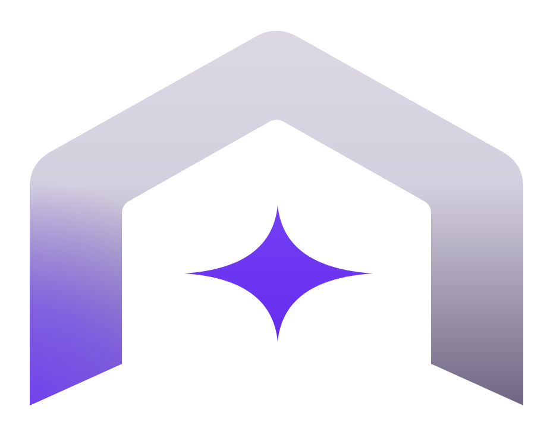
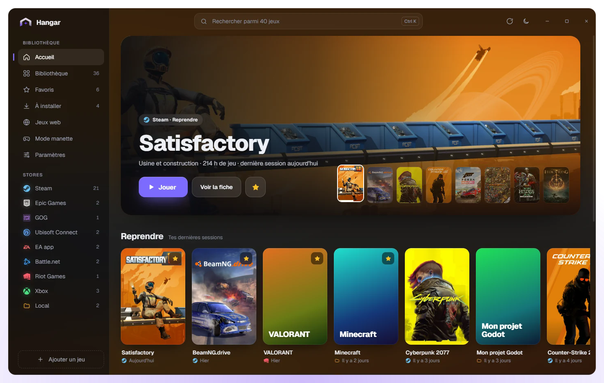

 

<h3>
  &nbsp;
  <a href="https://github.com/maelpasq/hangar">Hangar</a>
</h3>

Tous tes jeux, un seul launcher. **Steam, Epic, GOG, Ubisoft, EA, Battle.net, Riot et Xbox** réunis au même endroit, avec leurs vraies jaquettes. Windows et macOS.

 
 

  
  
  
  

